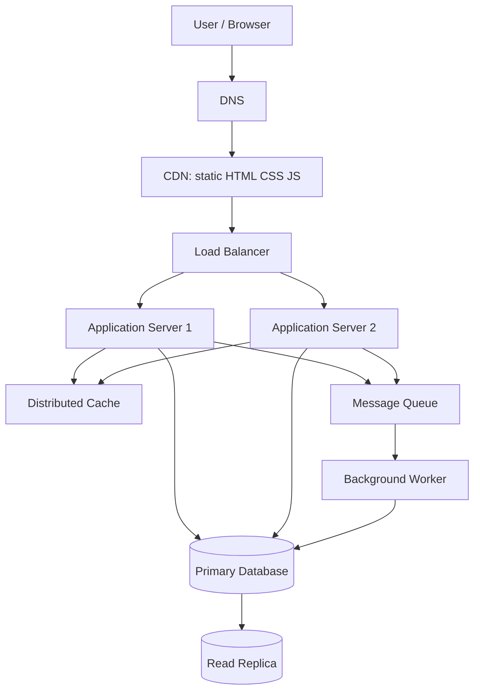

# QuickNotes System Architecture

## Functional requirements
1. Users can authenticate securely.
2. Users can create, list, view, edit and delete their own notes.
3. Users can add tags to notes and filter by tag.
4. The API validates input and returns consistent errors.
5. The interface shows loading, success, empty and error states.

## Non-functional requirements
- **Availability:** target 99.9% monthly API availability.
- **Performance:** 95% of ordinary note-list requests should complete within 300 ms at the service layer under normal load.
- **Security:** HTTPS, secure password hashing, authorization checks, validation, rate limiting and managed secrets.
- **Scalability:** stateless application servers can scale horizontally.
- **Reliability:** automated backups, monitored queues, health checks and documented recovery procedures.
- **Maintainability:** automated tests, structured logs, metrics and API documentation.

## Capacity estimate for 1 million users

- **One-year storage projection:** Starting with 1 million users and 40 GB of raw note content, assume the user base grows by 10% each month and each user retains the same average amount of note data. After 12 monthly growth periods, estimated raw note storage is 40 GB × 1.1^12 ≈ 125 GB. This is a projection of the total storage needed at the end of the period, not the sum of each month's storage. It excludes indexes, metadata, replicas, logs and backups and should be validated against real measurements.

Calculations:
- Reads/day = 100,000 × 20 = 2,000,000.
- Writes/day = 100,000 × 2 = 200,000.
- Average reads/second over 10 hours = 2,000,000 ÷ 36,000 ≈ 56; estimated peak ≈ 278 reads/second.
- Average writes/second over 10 hours = 200,000 ÷ 36,000 ≈ 6; estimated peak ≈ 28 writes/second.
- Current note storage = 1,000,000 × 20 × 2 KB ≈ 40 GB raw note content.
- For a simple one-year growth model, assume the user base grows by 10% monthly. Estimated raw note content for each month, summed over 12 months, is roughly 40 GB × (1 + 1.1 + ... + 1.1^11) ≈ 765 GB. This excludes indexes, metadata, replicas, logs and backups and should be validated against real measurements.

## Architecture diagram

## What each component solves
- **Client/browser:** provides the interface and sends HTTPS requests without database credentials.
- **DNS:** maps the service domain to the public entry point and allows controlled endpoint changes.
- **CDN:** serves versioned static assets near users and reduces application-server traffic.
- **Load balancer:** distributes requests across healthy application servers and removes unhealthy instances from rotation.
- **Application servers (at least two):** run validation, authorization and business logic; multiple instances support horizontal scaling.
- **Distributed cache:** reduces repeated reads for frequently requested data; cache entries need expiry and invalidation rules.
- **Primary database:** stores authoritative user, note and tag records and accepts writes.
- **Read replica:** serves suitable read traffic and reduces primary load; replication may be slightly delayed.
- **Message queue:** buffers asynchronous work so worker slowdowns do not block user-facing requests.
- **Background worker:** processes queued work such as notifications, exports or cleanup jobs.

## GET `/api/v1/notes` request flow
1. The browser resolves the API domain through DNS and sends an HTTPS request.
2. The load balancer selects a healthy application server.
3. The server validates the access token and confirms the user identity.
4. The server checks the cache for the user's first page of notes.
5. On a cache miss, the server queries the primary or an appropriate read replica, applying ownership and pagination filters.
6. The server returns JSON with note data and pagination metadata; safe results may be cached briefly.

## POST `/api/v1/notes` request flow
1. The browser sends an HTTPS POST with a bearer token and JSON title/body.
2. The load balancer routes the request to a healthy application server.
3. The server authenticates the user, checks authorization, validates the title and validates any tag IDs.
4. The server inserts the note into the primary database inside a transaction.
5. The server invalidates relevant cached note lists and may publish an event to the queue for non-critical follow-up work.
6. The server returns `201 Created` with the created note and its ID.

## Trade-offs and failure handling
1. **Cache vs. freshness:** caching improves read latency but can return stale data. Use short TTLs and invalidate a user's note-list cache after writes.
2. **Read replica vs. consistency:** replicas scale reads but may lag. Send writes to the primary and use the primary for reads needing immediate read-after-write consistency.
3. **Queue vs. immediate completion:** queues protect request latency, but jobs may be delayed. Make workers idempotent, retry transient failures with limits, and use a dead-letter queue.
4. **Managed database vs. self-hosting:** managed databases reduce operational burden but may cost more and introduce provider dependence. Keep backups portable and test restores.

## Avoiding single points of failure
Run at least two application servers across separate failure zones behind a health-checking load balancer. Use a highly available managed database configuration with automated failover, backups and a tested restore plan. Deploy cache and queue services in replicated/managed configurations. Monitor health, latency, queue depth, replication lag and error rates, and document incident response steps.

